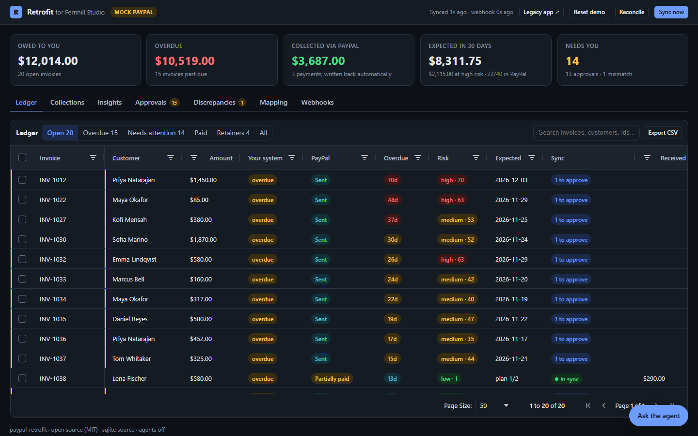
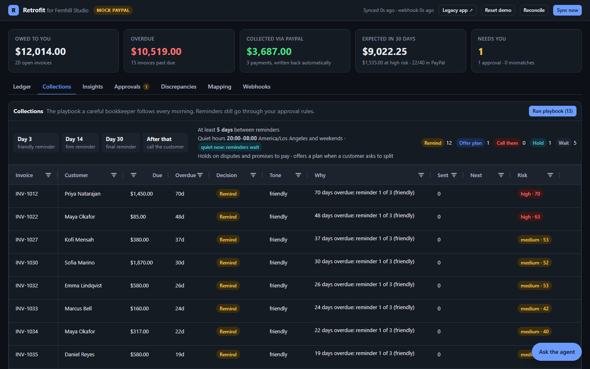

# paypal-retrofit

**Give any existing business a PayPal brain.** paypal-retrofit is an open-source SDK, CLI and console that lets an AI agent wire PayPal into a business system that already exists: its own database, its own invoice numbers, its own customers. Then it keeps both sides reconciled, with an agent that never moves money without a rule the owner set.

> Built for the [PayPal AI Hackathon](https://paypalaihackathon.devpost.com/) (October–November 2026). MIT licensed. Website: <https://thinkelution.github.io/paypal-retrofit/>

## The problem

Most small businesses already run on something: a booking tool, an old invoicing app, a spreadsheet export, a custom ERP. Adding PayPal usually means a developer reading API docs for a week, writing glue code against a schema they did not design, and then someone marking invoices as paid by hand forever because nobody wired the webhooks back.

PayPal's Agent Toolkit and MCP server let an AI agent *call* PayPal. Nothing lets an agent *retrofit* PayPal into a system that was never built for it. That is this project.

## What it does

- **Maps your data to PayPal in one command.** `paypal-retrofit init` reads your schema (SQLite, Postgres or a folder of CSV exports), and Claude proposes how customers, services, invoices, line items and recurring agreements become PayPal objects, with a reason for every choice. You review it; nothing touches PayPal yet.
- **Sends invoices and subscriptions through PayPal, and writes the results back.** `sync` creates PayPal invoices with your own invoice numbers, emails customers a pay link, and writes the PayPal id and link into the columns you allowed. Payments arrive by verified webhook and flip your legacy record to paid with the amount and date. A reconciler repairs anything a lost webhook missed.
- **Runs your receivables with an agent you control.** The Ops agent answers “who owes us the most?” or “why is INV-1042 still unpaid?” from your database and PayPal, and lines up reminders, recorded payments or refunds. Every side effect goes through a policy you set: `auto`, `confirm` (waits for your approval) or `never`.



## Built for how small businesses actually get paid

Beyond connecting PayPal, retrofit runs the receivables work a careful bookkeeper would. Each feature is deterministic and explained in plain language; Claude writes and advises, the engine decides. Full scenarios: [docs/use-cases.md](docs/use-cases.md).

| Situation | What retrofit does |
| --- | --- |
| **Monday-morning collections** | A playbook decides for every overdue invoice: remind (friendly at day 3, firm at day 14, final at day 30), wait, hold (dispute or a promise to pay), offer a plan, or call. Claude personalises each reminder from the customer's history. |
| **"Can I pay in two parts?"** | Turns the invoice into instalments with PayPal's native partial payments, tracks the schedule, reminds per instalment and writes the running total back. |
| **A refund requested on the phone** | Approval rules by amount (refunds up to $100 run on their own), daily caps ($500 of automatic refunds a day), and "never" for accepting disputes. Every action says which rule applied. |
| **No reminders at 2 a.m.** | Quiet hours in the business's time zone, including weekends and daylight saving. Approved reminders are scheduled for the morning; **Send now** overrides. |
| **"Will we make payroll?"** | Late-payment risk per invoice, learned from each customer's own history, and a 9-week cash forecast with its assumptions stated. |
| **Month-end close** | A payments ledger with gross, PayPal fee and net per payment. Exports as CSV, a Xero bank statement or a QuickBooks bank upload. |



## Try it in two minutes (no accounts needed)

```bash
git clone https://github.com/Thinkelution/paypal-retrofit.git
cd paypal-retrofit
corepack enable
pnpm install
pnpm build
pnpm retrofit demo --fresh
```

Open <http://localhost:8787>. You get three things in one process:

| URL | What it is |
| --- | --- |
| `/` | The Retrofit console (ledger, approvals, discrepancies, mapping, webhooks, agent) |
| `/fernhill` | **Fernhill Studio**, a fictional photography studio's old invoicing app. 40 invoices, 17 overdue, all marked paid by hand |
| `/mock-paypal` | A local stand-in for the PayPal endpoints retrofit uses, with buyer pay pages and signed webhooks |

Then: press **Send 22 invoices through PayPal**, open any invoice, press **Pay as customer**, pay it, and watch the legacy app's row turn `paid`. Add `ANTHROPIC_API_KEY` to `.env` to switch on Claude for mapping and the Ops agent.

To run against the **real PayPal sandbox** instead, see [Using the PayPal sandbox](#using-the-paypal-sandbox).

## Use it on your own system

```bash
cp .env.example .env            # add PayPal sandbox credentials and ANTHROPIC_API_KEY
pnpm retrofit init --source sqlite:./path/to/app.db     # or postgres://… or csv:./exports
pnpm retrofit doctor
pnpm retrofit sync --dry-run
pnpm retrofit sync
pnpm retrofit serve             # webhooks + console + background sync/reconcile
pnpm retrofit webhooks register --url https://your-host/webhooks/paypal
```

| Command | What it does |
| --- | --- |
| `init` | Introspect the source, let Claude (or the built-in heuristic) propose a mapping, write `retrofit.config.yaml` + `retrofit.map.json` |
| `sync [--dry-run] [--watch]` | Plan and push: create/send/update invoices, cancel voided ones, record payments made outside PayPal, create subscriptions |
| `reconcile` | Compare every linked record with PayPal, repair missed payments, fill missing fees, list discrepancies |
| `collections [--run]` | The collections playbook's decision for every open invoice; `--run` queues the reminders and plan offers |
| `forecast` | Cash expected over the next 9 weeks and the riskiest invoices |
| `export journal --month YYYY-MM --format xero` | Payments with gross, fee and net, for your accountant |
| `serve` | Webhook receiver, REST API and console, with background sync (every `sync.intervalSeconds`) and reconciliation |
| `chat` | The Ops agent in your terminal |
| `actions [--approve id] [--reject id] [--run-now id]` | Pending and scheduled actions from the terminal |
| `webhooks register --url` | Create the PayPal webhook with the right event list |
| `status`, `doctor` | Totals; checks for config, source, mapping, PayPal credentials, webhook and Claude |
| `demo [--sandbox]` | The Fernhill demo in one process |

## How it works

```
 legacy DB / CSV ──read──▶  paypal-retrofit engine  ──REST──▶  PayPal
        ▲                    · adapters (sqlite/pg/csv)          Invoicing v2
        │ write-back         · mapping (retrofit.map.json)       Catalog, Plans,
        │ (allowed columns)  · sync planner + policy gate        Subscriptions
        └────────────────────· webhook handler  ◀──signed events──  Webhooks
                             · reconciler + state store          Disputes, Reporting
                             · agents (Claude)
                               Mapper · Ops · Support
```

- **The deterministic engine moves money; agents propose and explain.** Every PayPal write is an *action* with an idempotency key, recorded in retrofit's state store and decided by the owner's policy.
- **Your schema is never altered.** Retrofit reads your tables and writes only to columns the mapping names (for example `paypal_invoice_id`, `paid_at`). Without such columns, links live in retrofit's own state.
- **Webhooks are verified with PayPal** (`/v1/notifications/verify-webhook-signature`), stored once per event id, and applied before PayPal gets a 200. Failures return 500 so PayPal retries; the reconciler is the backstop.

More detail: [ARCHITECTURE.md](ARCHITECTURE.md).

## PayPal features used

| Area | Endpoints / tools |
| --- | --- |
| Invoicing v2 | create, get, update, send, remind, cancel, record payment, record refund, search; **partial payments** (`configuration.partial_payment`) for payment plans |
| Payments v2 | capture refund |
| Catalog Products v1, Subscriptions v1 | product, plan and subscription creation, status, cancel |
| Webhooks v1 | create webhook, list, verify signature; 15 event types (invoice paid/cancelled/refunded, captures, subscriptions, sales, disputes) |
| Disputes v1 | list, get, accept claim (policy `never` by default) |
| Transaction Search | PayPal fees for the payments ledger when a capture webhook was missed; agent tool |
| **PayPal Agent Toolkit** (`@paypal/agent-toolkit`) | Supplies the Ops agent's read-only PayPal tools (invoices, disputes, transactions, insights, subscriptions, plans, products) in sandbox and production. Writes are deliberately not exposed to the agent. |

## AI used

| Agent | Model | What it does |
| --- | --- | --- |
| **Mapper** | Claude (`claude-opus-5-5`) via the official `@anthropic-ai/sdk`, structured outputs | Reads the masked schema and proposes a typed mapping with rationale, confidence and warnings. The result is validated against the real schema; if it fails, retrofit falls back to its deterministic mapper. |
| **Ops** | Claude via the SDK tool runner | Answers receivables questions using the ledger, read-only SQL on the legacy database, PayPal Agent Toolkit tools, the collections plan, payment risk, customer history, the cash forecast and month-end figures. Acts only through `propose_action` and `run_collections`, which the policy engine decides. |
| **Support** | Claude, structured outputs | Drafts a dispute response and evidence checklist from the PayPal dispute and the legacy invoice. Text only; the owner submits it. |
| **Reminder writer** | Claude, structured outputs, low effort | Writes each collections reminder in the requested tone from the invoice facts and the customer's payment history. Told never to threaten, mention fees or legal action, or invent facts. Falls back to templates. |

Guardrails: personal data is masked before it reaches the model (sample rows, tool results); SQL from the agent runs on a read-only connection; no forced tool choice; refusals are handled and fall back server-side; the agent cannot claim an action happened unless the engine reports it executed.

## Using the PayPal sandbox

1. Create a sandbox REST app at <https://developer.paypal.com> (Apps & Credentials → Sandbox). Put `PAYPAL_CLIENT_ID`, `PAYPAL_CLIENT_SECRET` and `PAYPAL_ENVIRONMENT=SANDBOX` in `.env`.
2. Note a sandbox **personal** (buyer) account under Testing Tools → Sandbox Accounts. Seed Fernhill so some customers use that email: `pnpm fernhill:seed -- --buyer <buyer-email>`.
3. Run with a public HTTPS URL so PayPal can reach the webhook (Render, or a tunnel such as `cloudflared tunnel --url http://localhost:8787`):
   ```bash
   RETROFIT_PUBLIC_URL=https://your-tunnel.example pnpm retrofit demo --sandbox --fresh
   ```
   The demo registers the webhook itself. Each sandbox run uses a short invoice-number prefix so reruns never collide.
4. Check everything with `pnpm smoke:sandbox` (creates, sends and records one invoice against the live sandbox).

Live (production) mode is refused unless `RETROFIT_ALLOW_LIVE=1`. It has not been tested.

## Sponsor tools

- **AG Grid Community** (MIT) powers every table in the console: the ledger (filters, quick search, row selection for bulk reminders, custom status and risk renderers, row highlighting, CSV export, pagination), the collections playbook, late-payment risk, customer payment behaviour, approvals with scheduled actions, discrepancies, webhook activity and the editable mapping grids (select editors, boolean editors).
- **Render**: `render.yaml` deploys the whole demo as one web service.

## Repository layout

```
packages/core         engine: adapters, mapping, PayPal client, sync, webhooks, reconcile, ledger,
                      policy rules, collections, payment plans, risk, forecast, journal
packages/agents       Claude agents: Mapper, Ops (tool runner + PayPal Agent Toolkit), Support
packages/server       Express API, webhook endpoint, SSE live updates
packages/dashboard    React + AG Grid console
packages/cli          paypal-retrofit CLI
packages/mock-paypal  local PayPal stand-in for tests and offline demos
site/                 landing page, deployed to GitHub Pages by .github/workflows/pages.yml
examples/legacy-invoicer  Fernhill Studio, the legacy app
```

## Development

```bash
pnpm test        # 27 tests: engine, webhooks, reconcile, CSV, policies, quiet hours, plans, collections,
                 # risk, forecast, fees, agents (offline, against the mock and a fake Messages API)
pnpm typecheck
pnpm lint
pnpm dashboard:dev   # Vite dev server on :5173, proxied to a running `retrofit demo`
```

## Limitations

- Sandbox first. The code follows PayPal's REST reference, but the full flow has been exercised end to end only against the bundled mock; run `pnpm smoke:sandbox` with your credentials to check the live sandbox.
- One currency per mapping. Taxes, discounts and partial refunds are passed through but not modelled.
- Risk and forecast are transparent heuristics learned from your own history, not a credit model. They get better as more invoices are paid through retrofit.
- Not a compliance product. It does not handle card data; PayPal does.

## License

[MIT](LICENSE)
