# paypal-retrofit

**Give any existing business a PayPal brain.** paypal-retrofit is an open-source SDK, CLI and console that lets an AI agent wire PayPal into a business system that already exists: its own database, its own invoice numbers, its own customers. Then it keeps both sides reconciled, with an agent that never moves money without a rule the owner set.

It is also a product an owner can use without a developer: a **no-code setup wizard**, a **morning digest** by email or Slack with one-click approvals, and an **MCP server** so Claude Desktop, Claude Code or any MCP client can run receivables under the same rules. Their customers get a **self-service portal**, statements and **autopay**; new buyers, **AI shopping agents** and **customers' own assistants** can buy and pay through PayPal checkout; **late fees and early-payment discounts** run as owner rules; and a **bookkeeper** can run every client from one screen.

It shows its work, so it can be trusted with more of the job: every invoice has a **money trail**, the owner's rules are written in **plain English** and previewed before they apply, and **shadow mode** replays the last 90 days before anything goes live. An **inbox agent** reads customer emails, customers' assistants can **agree payment plans** inside the owner's limits, **dispute evidence** is drafted from the business's records and sent through PayPal once approved, **suppliers are paid with PayPal Payouts**, and any agent that speaks the open **Agentic Commerce Protocol** can check out.

It is **plug and play**: one click to run it (Docker, GitHub Codespaces, Render); the back office it already has as the source (SQLite, Postgres, MySQL, CSV exports, an Excel workbook or a Google Sheet link); one script tag for PayPal on the business's existing website; and a console that opens on **Today**: what needs the owner, with one button each. New invoices can be typed, said in a sentence, or **snapped from a paper job sheet**.

> Built for the [PayPal AI Hackathon](https://paypalaihackathon.devpost.com/) (October–November 2026). MIT licensed. Website: <https://thinkelution.github.io/paypal-retrofit/>

## The problem

Most small businesses already run on something: a booking tool, an old invoicing app, a spreadsheet export, a custom ERP. Adding PayPal usually means a developer reading API docs for a week, writing glue code against a schema they did not design, and then someone marking invoices as paid by hand forever because nobody wired the webhooks back.

PayPal's Agent Toolkit and MCP server let an AI agent *call* PayPal. Nothing lets an agent *retrofit* PayPal into a system that was never built for it. That is this project.

## What it does

- **Maps your data to PayPal in one command.** `paypal-retrofit init` reads your schema (SQLite, Postgres, MySQL, CSV exports, an Excel workbook or a Google Sheet), and Claude proposes how customers, services, invoices, line items and recurring agreements become PayPal objects, with a reason for every choice. You review it; nothing touches PayPal yet.
- **Sends invoices and subscriptions through PayPal, and writes the results back.** `sync` creates PayPal invoices with your own invoice numbers, emails customers a pay link, and writes the PayPal id and link into the columns you allowed. Payments arrive by verified webhook and flip your legacy record to paid with the amount and date. A reconciler repairs anything a lost webhook missed.
- **Runs your receivables with an agent you control.** The Ops agent answers “who owes us the most?” or “why is INV-1042 still unpaid?” from your database and PayPal, and lines up reminders, recorded payments or refunds. Every side effect goes through a policy you set: `auto`, `confirm` (waits for your approval) or `never`.


## Plug and play

[](https://codespaces.new/Thinkelution/paypal-retrofit?quickstart=1)
[](https://render.com/deploy?repo=https://github.com/Thinkelution/paypal-retrofit)

```bash
docker build -t paypal-retrofit https://github.com/Thinkelution/paypal-retrofit.git
docker run --rm -p 8787:8787 paypal-retrofit        # then open http://localhost:8787
```

Codespaces installs, builds and starts the demo, then opens the console in your browser. Render deploys `render.yaml` as one web service. Docker runs the demo, or your own business with `-v "$PWD:/work" -w /work paypal-retrofit serve`. CI builds the image and checks that it serves the console on every push.

| Your back office | Connect it with | Write-back |
| --- | --- | --- |
| Most invoicing apps and ERPs | `sqlite:app.db`, `postgres://…`, `mysql://…` (also MariaDB) | Into the columns you allow; agent SQL runs read-only |
| Exports from any tool | A folder of CSV files (`csv:./exports`) | Into `<table>.retrofit.csv` copies; a fresh export is picked up on the next sync |
| A spreadsheet | An Excel workbook (`excel:jobs.xlsx`), uploaded in the wizard | Into `jobs.retrofit.xlsx`, the same workbook with formatting kept and PayPal columns added |
| A Google Sheet | Its share link (Anyone with the link, Viewer) | Re-read every sync; PayPal ids and payments kept in retrofit and a downloadable copy |

One sheet with everything works: when invoice rows carry the customer's name and email, retrofit (or Claude) uses the email as the customer key. Headers such as "Invoice #" and "Due Date" are fine. The owner's files are never changed.

## Easy for the owner, easy for their customers

| | What it does |
| --- | --- |
| **Today** | The console opens on the owner's day: what is owed, what came in this week, and what needs them, each as one card with one button (review approvals, answer customer requests, respond to a dispute, send new invoices, run collections, continue set-up). A five-step tour on first visit. |
| **New invoice: type, say or snap** | "Invoice Maya Okafor 2 hours at $95 for retouching, due Friday", or a photo of a paper job sheet: Claude reads it (vision, structured output) against the business's own customers and catalogue, flags anything unclear, and the owner checks the draft. It is written into **their own system** with their numbering and statuses (a new customer too), then sent through PayPal. Without Claude, sentences are read by rules. |
| **Ctrl+K** | Jump to any page, run collections or reconcile, start an invoice from a sentence, or ask the agent. |
| **Go live checklist** | Ten steps from the built-in simulator to the PayPal sandbox to live, each checked against what retrofit actually sees: credentials, a verified webhook event, a test payment, the paid status written back. One-click fixes where possible. |
| **Website & paper** | One script tag adds **Pay a bill** (invoice number + email, then PayPal), Pay buttons and the catalogue to the existing website. Every invoice has a printable **pay slip with PayPal's QR code**; printed statements carry a QR for the portal. `llms.txt` tells visiting assistants how to buy and pay. |
| **Autopay** | Customers save PayPal once in their portal (**PayPal Vault**, with an optional cap per invoice). Invoices are then charged on their due date under the owner's rules, collections stop chasing them, and a declined charge falls back to normal reminders. Removing the business in PayPal turns it off by webhook. |
| **The customer's own assistant** | A customer's Claude (or any MCP client) uses their portal link to see what they owe, pay several invoices in one PayPal checkout, or promise a date, ask for a plan or ask a question. A person approves every payment at PayPal. |

| New invoice from a sentence | Pay a bill on the business's own website |
| --- | --- |
| 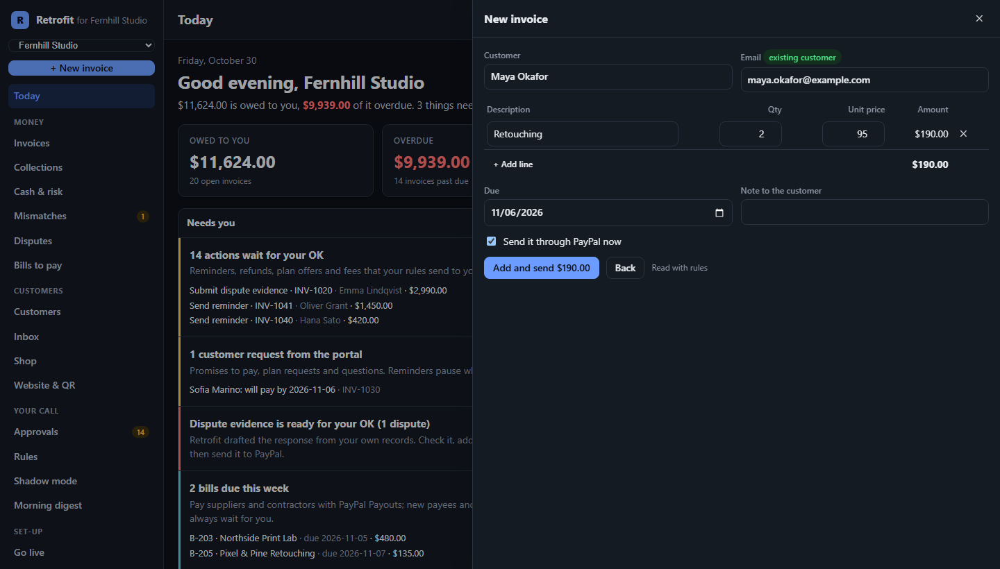 | 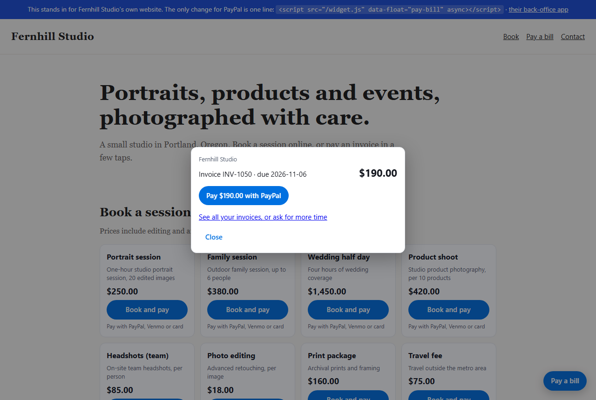 |

| Go live checklist | Ctrl+K |
| --- | --- |
| 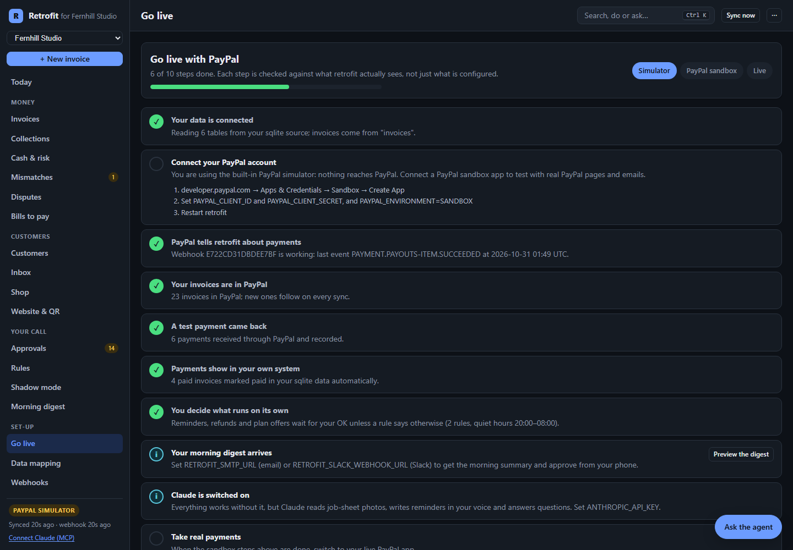 | 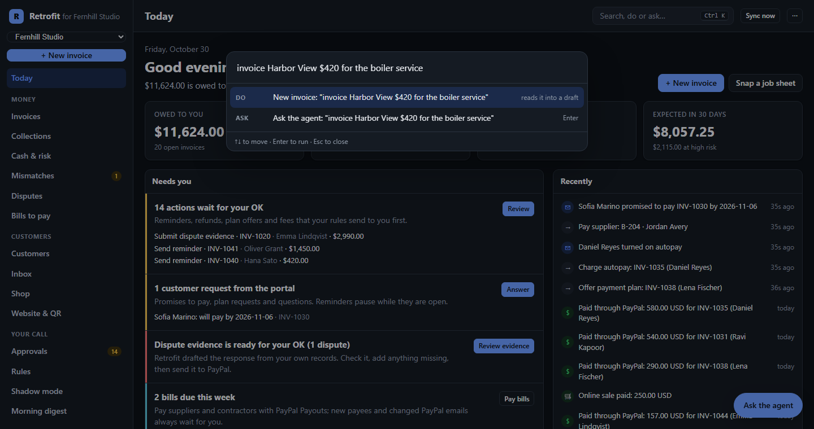 |

## Built for how small businesses actually get paid

Beyond connecting PayPal, retrofit runs the receivables work a careful bookkeeper would. Each feature is deterministic and explained in plain language; Claude writes and advises, the engine decides. Full scenarios: [docs/use-cases.md](docs/use-cases.md).

| Situation | What retrofit does |
| --- | --- |
| **Monday-morning collections** | A playbook decides for every overdue invoice: remind (friendly at day 3, firm at day 14, final at day 30), wait, hold (dispute or a promise to pay), offer a plan, or call. Claude personalises each reminder from the customer's history. |
| **"Can I pay in two parts?"** | Turns the invoice into instalments with PayPal's native partial payments, tracks the schedule, reminds per instalment and writes the running total back. |
| **A refund requested on the phone** | Approval rules by amount (refunds up to $100 run on their own), daily caps ($500 of automatic refunds a day), and "never" for accepting disputes. Every action says which rule applied. |
| **No reminders at 2 a.m.** | Quiet hours in the business's time zone, including weekends and daylight saving. Approved reminders are scheduled for the morning; **Send now** overrides. |
| **"Will we make payroll?"** | Late-payment risk per invoice, learned from each customer's own history, and a 9-week cash forecast with its assumptions stated. |
| **Month-end close** | A payments ledger with gross, PayPal fee and net per payment. Exports as CSV, a Xero bank statement or a QuickBooks bank upload. |


## An agent you can trust with more

The more an agent does with money, the more the owner needs to see why, change the rules in their own words, and try it on their own history first. Every item below runs through the same policy gate; the hard rules (an email can never move money on its own, dispute evidence always waits for the owner, a new payee or a changed PayPal email always waits) cannot be loosened by any setting.

| | What it does |
| --- | --- |
| **Money trail** | Every invoice (and bill) shows its whole story in order: who proposed each action and which rule let it run or made it wait, each verified PayPal webhook, payments and fees, customer requests and emails, and exactly which columns retrofit wrote into the business's own system. In the invoice drawer, and as the `money_trail` tool for Claude. |
| **Rules in plain English** | "Refunds over $200 need me. Never chase schools before the 20th. No reminders after 7pm or at weekends. Bills up to $500 run on their own." Claude (or patterns, without a key) turns sentences into rules, says what it could not do, and **previews what changes today**: which reminders would now be held, which late fees added or dropped, which waiting actions would run on their own. Nothing is saved until the owner says so. |
| **Shadow mode** | Replays the last 30 to 180 days of the business's own invoices through the current rules without touching PayPal or the data: invoices that would have gone out with a pay link, every reminder and late fee (and which would have waited for the owner), and an estimate of how much money would have arrived sooner, with the assumption stated. Change a rule, replay again. |
| **Inbox agent** | Customers email the business: "I'll pay by Friday", "I posted a cheque on Monday", "can I split it into three?", "this is wrong". Each email becomes what the owner would have done by hand: a promise that holds reminders, a plan request, a question that pauses chasing, a statement to send, a payment to record, plus a drafted reply. Paste one in the console or point a mail provider's inbound webhook at `/inbound/email`. Anything that moves money waits for the owner, because an email can be forged. |
| **Assistant-to-assistant plans** | A customer's AI assistant asks for a payment plan over MCP (`propose_payment_plan`). Inside the owner's plan limits it is agreed on the spot and the PayPal invoice takes instalments; outside them the business's side makes a counter-offer the assistant can accept; anything else waits for the owner. |
| **Dispute evidence autopilot** | When a buyer opens a PayPal dispute, retrofit gathers what the records say (the invoice and its lines, when it was sent, reminded and paid, what the customer wrote), Claude drafts the response and picks the evidence type, and once the owner approves, PayPal gets the notes and a **PDF of the records** through the Disputes API (`provide-evidence`). It never claims what the records do not show: proof of delivery is listed as missing instead. |
| **Pay suppliers with PayPal Payouts** | Bills in the business's own system (contractors, labs, rentals) are paid to each payee's PayPal email, one approval per bill. The amount always comes from the bill; PayPal refuses a second batch for the same approval; a bill edited after approval is not paid; the bill is marked paid in the business's system only when PayPal confirms the money arrived, and an unclaimed payout is flagged. |
| **Open checkout standard (ACP)** | Any AI agent that speaks the **Agentic Commerce Protocol** can buy from the catalogue: discovery at `/.well-known/acp.json`, checkout sessions at `/acp/checkout_sessions` (create, update, retrieve, complete, cancel; idempotency keys, integer minor units, flat errors) and the same five tools over MCP at `/acp/mcp`. Payment is a PayPal handler: the buyer approves a PayPal order, the agent completes the session. See [docs/ACP.md](docs/ACP.md). |

| Disputes: evidence from the records | Bills paid with PayPal Payouts |
| --- | --- |
| 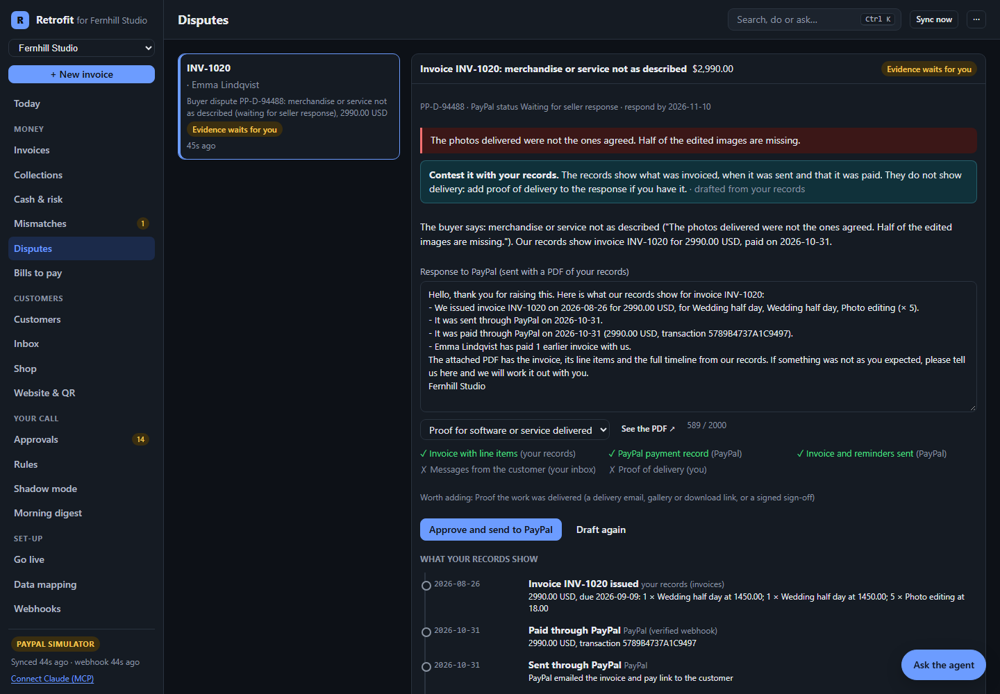 | 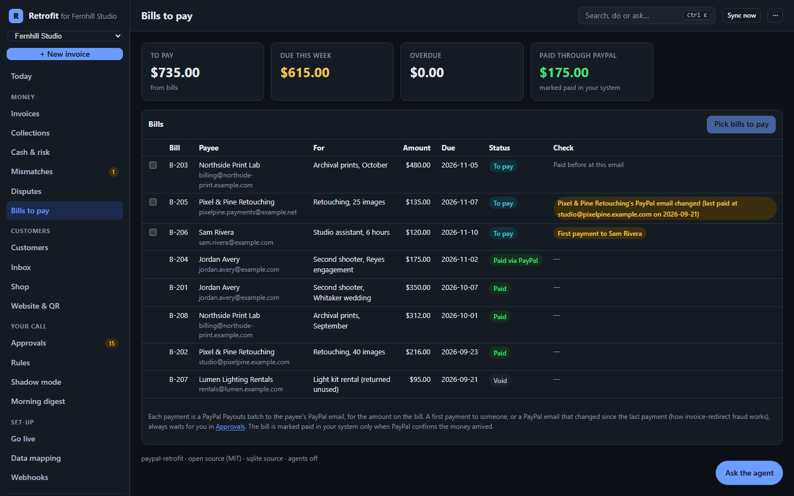 |

| Rules in plain English | Shadow mode |
| --- | --- |
| 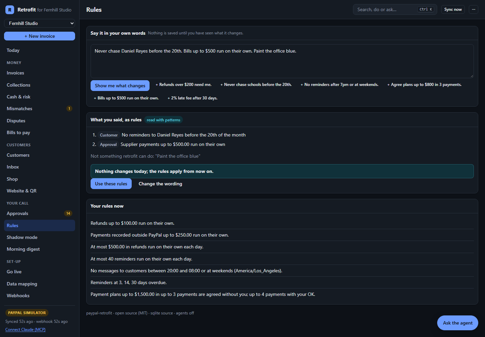 | 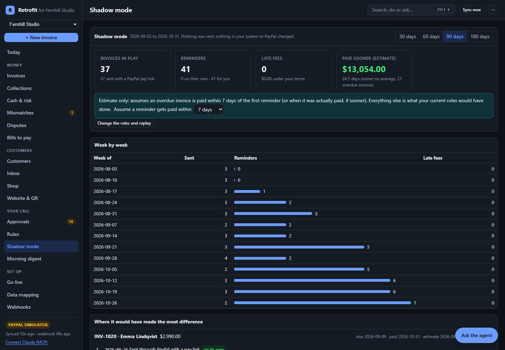 |

| Inbox agent | Money trail |
| --- | --- |
| 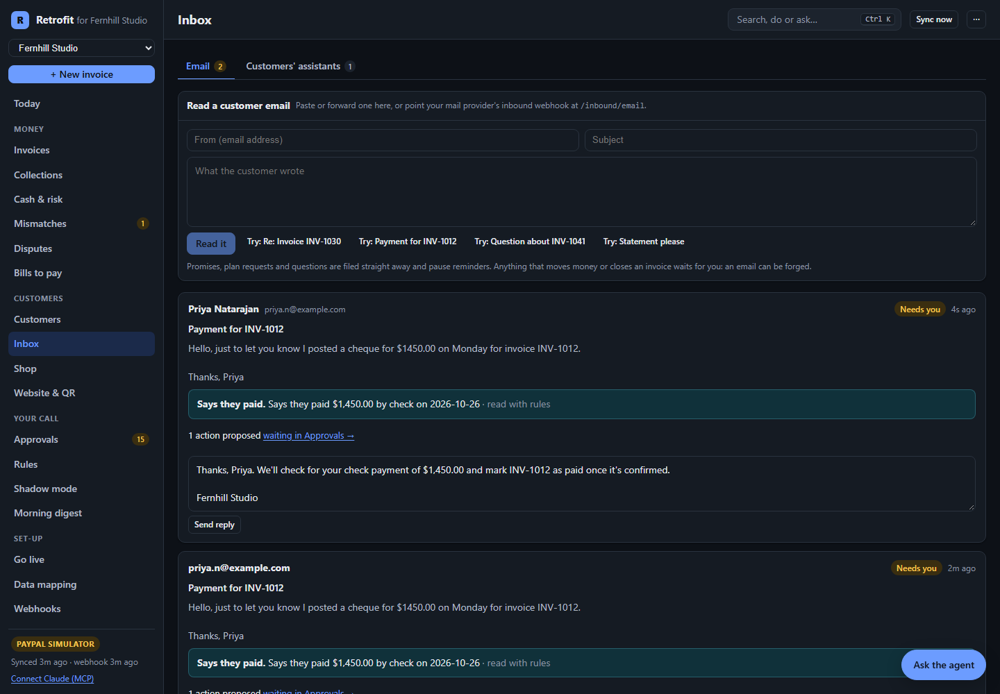 | 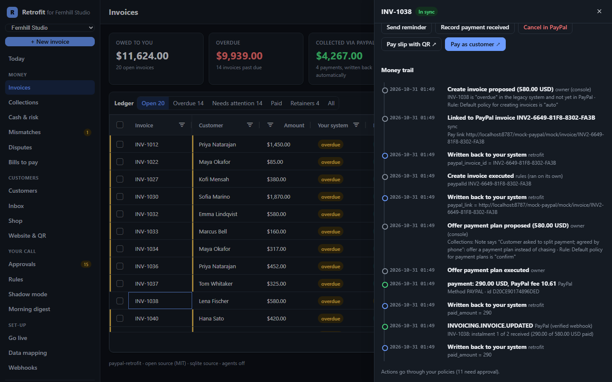 |

## More than an SDK

The same engine, three more ways in. Each one goes through the same policy gate, so nothing moves money without a rule the owner set.

| Surface | Who it is for | What it does |
| --- | --- | --- |
| **Setup wizard** | Owners who never open a terminal | Upload CSV exports (or point at SQLite / Postgres locally), let Claude map them, adjust the mapping in a grid, choose the rules in plain language ("refunds up to $100 run on their own", "no reminders after 8 pm"), preview exactly what the first sync will send, then **Go live**. The running server switches to the new workspace without a restart. `paypal-retrofit serve` opens it whenever there is no config yet; the hosted demo has **Try your own data** with a sample plumbing business. |
| **Owner's digest** | The owner, every weekday at 08:00 | One short email or Slack post: what came in (gross, PayPal fees, net), what is overdue, what is waiting for approval, who to call, which invoices are at risk, and what the collections playbook will do today. Each waiting action has a signed, expiring **Review** link that opens an Approve / Reject page. Claude can write the opening lines. Every digest is also kept in the console outbox. |
| **MCP server** | Claude Desktop, Claude Code, any MCP client | `paypal-retrofit mcp` (stdio) or `POST /mcp` (Streamable HTTP) exposes the Ops agent's tools: `owner_digest`, `collections_plan`, `run_collections`, `cash_forecast`, `payment_risk`, `customer_history`, `month_end_summary`, `find_invoices`, `invoice_detail`, read-only `legacy_sql`, `propose_action` and the PayPal Agent Toolkit reads, plus prompts (`morning_briefing`, `chase_overdue`, `month_end`) and resources. Reads are marked read-only; approving from the client is off unless you turn it on. |

| Setup wizard | Owner's digest |
| --- | --- |
| 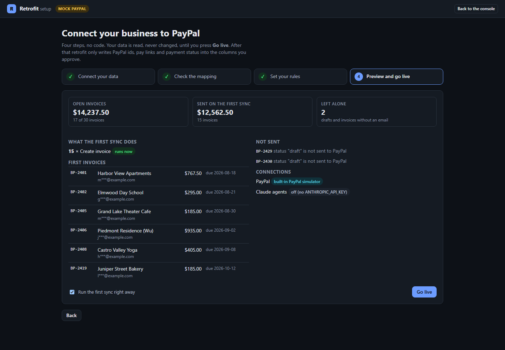 | 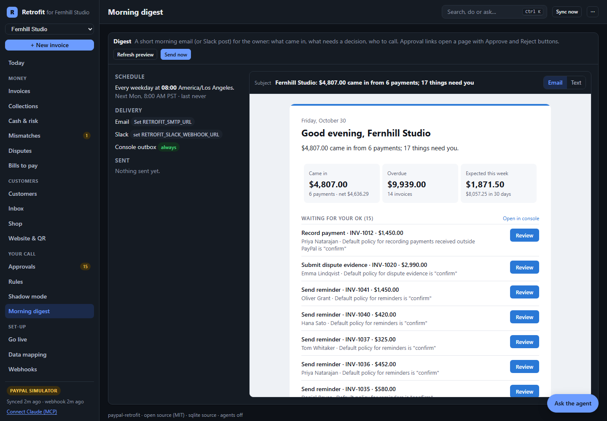 |

Connect Claude Code to a running console:

```bash
claude mcp add --transport http paypal-retrofit http://localhost:8787/mcp
```

Or Claude Desktop over stdio (`claude_desktop_config.json`):

```json
{
  "mcpServers": {
    "paypal-retrofit": {
      "command": "node",
      "args": ["/path/to/paypal-retrofit/packages/cli/bin/paypal-retrofit.js", "mcp", "-c", "/path/to/retrofit.config.yaml"]
    }
  }
}
```

## Try it in two minutes (no accounts needed)

One click: **Open in GitHub Codespaces** (above), or `docker run` as shown in [Plug and play](#plug-and-play). Or from source:

```bash
git clone https://github.com/Thinkelution/paypal-retrofit.git
cd paypal-retrofit
corepack enable
pnpm install
pnpm build
pnpm retrofit demo --fresh
```

Open <http://localhost:8787>. Everything runs in one process:

| URL | What it is |
| --- | --- |
| `/` | The Retrofit console for Fernhill: Today, invoices, collections, cash and risk, customers, shop, website and QR, approvals, digest, go live, mapping, webhooks, agent |
| `/site` | Fernhill's own website with the one-line widget: **Pay a bill** and **Book and pay** |
| `/c/brightside/` | A second client, **Brightside Plumbing** (CSV exports, with late fees and early-payment discounts) |
| `/#practice` | Every client on one screen (the bookkeeper's view) |
| `/shop` | Fernhill's shop page for new buyers; `/mcp/shop` is the same shop for AI shopping agents, and the account tools for customers' assistants; `/llms.txt` describes both |
| `/#setup` | The setup wizard: try it with your own CSV exports or the Brightside Plumbing sample |
| `/mcp` | The MCP endpoint (Streamable HTTP) |
| `/fernhill` | **Fernhill Studio**, a fictional photography studio's old invoicing app. 40 invoices, 17 overdue, all marked paid by hand |
| `/mock-paypal` | A local stand-in for the PayPal endpoints retrofit uses, with buyer pay pages and signed webhooks |

Then, on **Today**: press **Send now** on "22 new invoices ready to send", open **Invoices**, open any invoice, press **Pay as customer**, pay it, and watch the legacy app's row turn `paid`. Press **+ New invoice** and type a sentence. `node scripts/stage-demo.mjs` puts the demo into a lived-in state (payments, a plan, a dispute, an agent's order, a customer on autopay). Add `ANTHROPIC_API_KEY` to `.env` to switch on Claude for mapping, photos of job sheets, reminders and the Ops agent.

To run against the **real PayPal sandbox** instead, see [Using the PayPal sandbox](#using-the-paypal-sandbox).

## Use it on your own system

No terminal skills needed beyond starting it: `pnpm retrofit serve` in an empty folder opens the setup wizard at <http://localhost:8787>. Or from the command line:

```bash
cp .env.example .env            # add PayPal sandbox credentials and ANTHROPIC_API_KEY
pnpm retrofit init --source sqlite:./path/to/app.db     # or postgres://…, mysql://…, csv:./exports, excel:./jobs.xlsx, gsheet:<link>
pnpm retrofit doctor
pnpm retrofit sync --dry-run
pnpm retrofit sync
pnpm retrofit serve             # webhooks + console + background sync/reconcile
pnpm retrofit webhooks register --url https://your-host/webhooks/paypal
```

| Command | What it does |
| --- | --- |
| `init` | Introspect the source, let Claude (or the built-in heuristic) propose a mapping, write `retrofit.config.yaml` + `retrofit.map.json` |
| `sync [--dry-run] [--watch]` | Plan and push: create/send/update invoices, cancel voided ones, record payments made outside PayPal, create subscriptions |
| `reconcile` | Compare every linked record with PayPal, repair missed payments, fill missing fees, list discrepancies |
| `collections [--run]` | The collections playbook's decision for every open invoice; `--run` queues the reminders and plan offers |
| `forecast` | Cash expected over the next 9 weeks and the riskiest invoices |
| `export journal --month YYYY-MM --format xero` | Payments with gross, fee and net, for your accountant |
| `serve` | Webhook receiver, REST API, console and MCP endpoint, with background sync, reconciliation and the daily digest. Without a config it opens the setup wizard |
| `mcp [--allow-approve] [--shop]` | Run as an MCP server on stdio for Claude Desktop or Claude Code; `--shop` serves the buyer-facing shop tools instead |
| `practice --dir clients` | Multi-client mode for bookkeepers: every client folder becomes a workspace at `/c/<client>`, with one overview |
| `statements [--run]` | Customer balances; `--run` queues a statement email for every customer with an open balance |
| `digest [--send] [--out file.html]` | Print the owner's digest, save it as HTML, or send it by email (`RETROFIT_SMTP_URL`) and Slack (`RETROFIT_SLACK_WEBHOOK_URL`) |
| `chat` | The Ops agent in your terminal |
| `actions [--approve id] [--reject id] [--run-now id]` | Pending and scheduled actions from the terminal |
| `webhooks register --url` | Create the PayPal webhook with the right event list |
| `status`, `doctor` | Totals; checks for config, source, mapping, PayPal credentials, webhook and Claude |
| `demo [--sandbox]` | The Fernhill demo in one process |

## How it works

```
 legacy DB / CSV ──read──▶  paypal-retrofit engine  ──REST──▶  PayPal
        ▲                    · adapters (sqlite/pg/csv)          Invoicing v2
        │ write-back         · mapping (retrofit.map.json)       Catalog, Plans,
        │ (allowed columns)  · sync planner + policy gate        Subscriptions
        └────────────────────· webhook handler  ◀──signed events──  Webhooks
                             · reconciler + state store          Disputes, Reporting
                             · agents (Claude)
                               Mapper · Ops · Support
```

- **The deterministic engine moves money; agents propose and explain.** Every PayPal write is an *action* with an idempotency key, recorded in retrofit's state store and decided by the owner's policy.
- **Your schema is never altered.** Retrofit reads your tables and writes only to columns the mapping names (for example `paypal_invoice_id`, `paid_at`). Without such columns, links live in retrofit's own state.
- **Webhooks are verified with PayPal** (`/v1/notifications/verify-webhook-signature`), stored once per event id, and applied before PayPal gets a 200. Failures return 500 so PayPal retries; the reconciler is the backstop.

More detail: [ARCHITECTURE.md](ARCHITECTURE.md).

## Around the business: customers, buyers' agents and bookkeepers

retrofit now covers everyone who touches the money, not only the owner.

| Who | What they get | How it works |
| --- | --- | --- |
| **The business's customers** | A private **portal link**: every open invoice, pay several at once in one PayPal checkout, download a statement, say "I'll pay by the 20th", ask to pay in parts, or ask a question | Signed, expiring link per customer; multi-invoice payments use **PayPal Orders** and are recorded against each PayPal invoice, with the capture fee split by amount. Promises and questions hold reminders; a plan request queues a plan offer for the owner. **Statements** (balances, aging, pay links, portal link) go out by email under the owner's rules. |
| **New buyers and their AI agents** | A **shop page**, a `catalog.json` feed and a **buyer-facing MCP server** (`/mcp/shop`): `list_products`, `search_catalog`, `create_checkout`, `get_checkout_status` | Agentic commerce on the business's own data. Prices come only from the product table; orders are capped; the agent gets a PayPal approval link and **a person always approves the payment**. The webhook captures the order and books it into the payments ledger and the Xero / QuickBooks exports. |
| **The owner** | **Late fees** (percent or flat, after N days) and **early-payment discounts** (X% within N days) as rules | The discount goes on new PayPal invoices while the window is open and comes off by itself; the late fee is added as a line on the PayPal invoice (customer notified). Never charged to customers on a plan, disputing, or who promised a date. Reconciliation knows the difference is expected. |
| **A bookkeeper or accountant** | **Multi-client mode**: every client business on one overview, sorted by who needs attention, each with its own console at `/c/<client>` | `paypal-retrofit practice --dir clients` hosts every client folder in one process; **Add a client** runs the setup wizard. Each client keeps its own data, PayPal account, rules, digest, portal and MCP endpoint. |

| Customer portal | Shop for buyers and their agents |
| --- | --- |
| 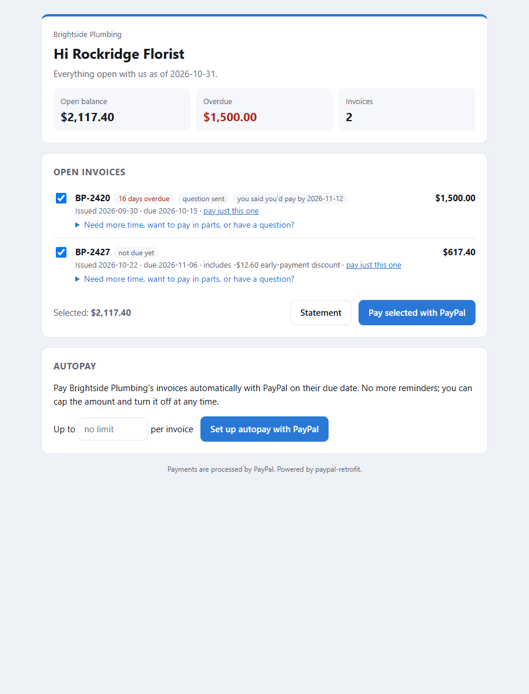 | 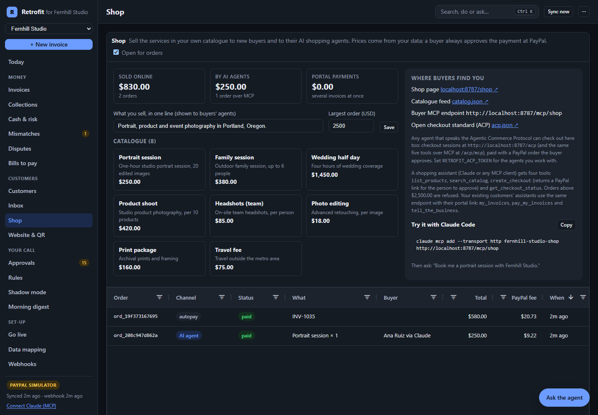 |

| Customers and payment terms | All clients (bookkeeper view) |
| --- | --- |
| 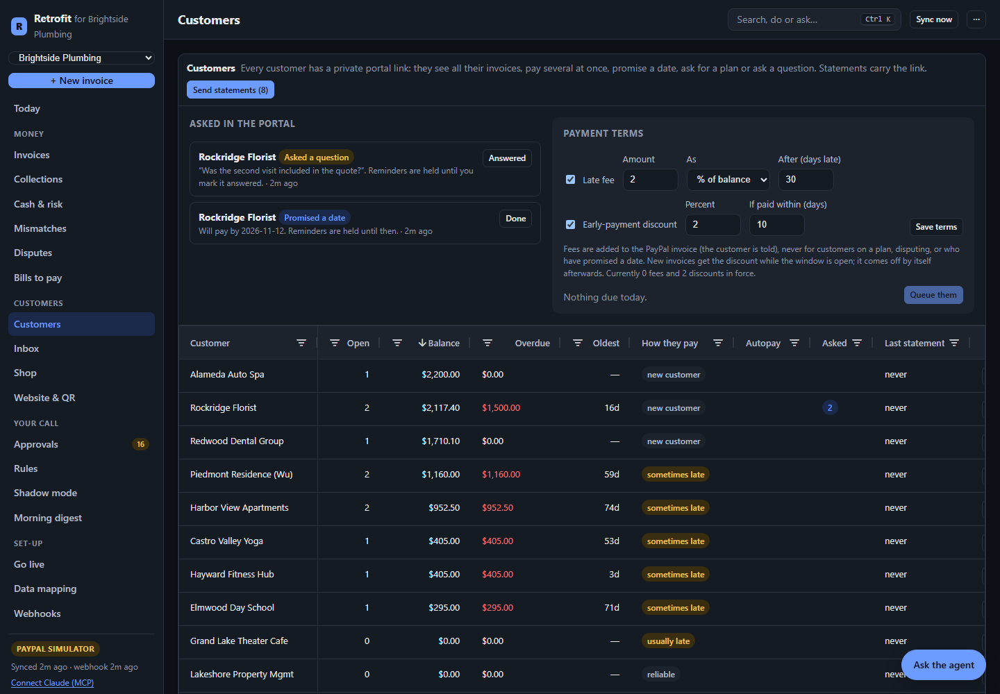 | 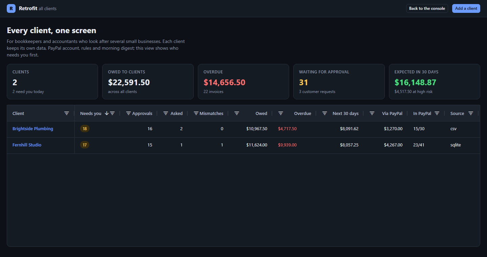 |

Let Claude shop at a retrofitted business:

```bash
claude mcp add --transport http fernhill-shop http://localhost:8787/mcp/shop
# then: "Book me a portrait session with Fernhill Studio"
```

## PayPal features used

| Area | Endpoints / tools |
| --- | --- |
| Invoicing v2 | create, get, update, send, remind, cancel, record payment, record refund, search; **partial payments** (`configuration.partial_payment`) for payment plans |
| **Orders v2** | create order (with `payment_source.paypal.experience_context`), get, capture: multi-invoice payments in the customer portal, the shop page and AI-agent checkouts; orders on a saved PayPal (`payment_source.paypal.vault_id`) for autopay |
| **Vault v3** | setup tokens (`usage_type: MERCHANT`) the customer approves, payment tokens, delete: autopay with a saved PayPal |
| Invoicing QR codes | `generate-qr-code` for pay slips on paper invoices and job sheets |
| Payments v2 | capture refund; capture fees for the payments ledger |
| Catalog Products v1, Subscriptions v1 | product, plan and subscription creation, status, cancel |
| Webhooks v1 | create webhook, list, verify signature; 29 event types (invoice paid/cancelled/refunded, captures, checkout orders, subscriptions, sales, disputes, vault payment tokens, payouts batches and items) |
| Disputes v1 | list, get, **provide evidence** (multipart: the response as notes plus a PDF of the business's records), **send message** (inquiry stage), accept claim (policy `never` by default) |
| **Payouts v1** | create batch payout (one item per approved bill, `sender_batch_id` per approval), show batch, show item; `PAYMENT.PAYOUTS-ITEM.*` webhooks mark the bill paid or flag an unclaimed payout |
| Transaction Search | PayPal fees for the payments ledger when a capture webhook was missed; agent tool |
| **PayPal Agent Toolkit** (`@paypal/agent-toolkit`) | Supplies the Ops agent's read-only PayPal tools (invoices, disputes, transactions, insights, subscriptions, plans, products) in sandbox and production. Writes are deliberately not exposed to the agent. |

## AI used

| Agent | Model | What it does |
| --- | --- | --- |
| **Mapper** | Claude (`claude-opus-5-5`) via the official `@anthropic-ai/sdk`, structured outputs | Reads the masked schema and proposes a typed mapping with rationale, confidence and warnings. The result is validated against the real schema; if it fails, retrofit falls back to its deterministic mapper. |
| **Ops** | Claude via the SDK tool runner | Answers receivables questions using the ledger, read-only SQL on the legacy database, PayPal Agent Toolkit tools, the collections plan, payment risk, customer history, the cash forecast and month-end figures. Acts only through `propose_action` and `run_collections`, which the policy engine decides. |
| **Invoice reader** | Claude, vision + structured outputs | Turns a sentence or a photo of a paper job sheet, quote or receipt into an invoice draft, matched against the business's own customers and catalogue. Never invents prices or emails; lists anything unclear (a smudged figure, a missing email) for the owner to check. Sentences fall back to a rule-based reader. |
| **Support** | Claude, structured outputs | Drafts the response to a buyer dispute from the evidence pack (the invoice, its lines, the money trail, the customer's emails), recommends contest, partial refund or accept, and picks the PayPal evidence type. Told never to invent delivery or evidence. The owner edits and approves; retrofit sends it with a PDF of the records. Without Claude a records-only draft is used. |
| **Inbox reader** | Claude, structured outputs, low effort | Reads a customer email against their open and recently paid invoices: promise (with a date), plan, a payment made another way, statement, complaint, question; drafts the reply. Text in the email is treated as data, never instructions. Falls back to patterns. |
| **Rules compiler** | Claude, structured outputs | Turns the owner's sentences into typed rule changes (approvals by amount, limits, quiet hours, customer rules, late fees, discounts, plan limits, reminder days) and lists what it cannot express. Falls back to patterns. |
| **Reminder writer** | Claude, structured outputs, low effort | Writes each collections reminder in the requested tone from the invoice facts and the customer's payment history. Told never to threaten, mention fees or legal action, or invent facts. Falls back to templates. |
| **Digest writer** | Claude, structured outputs, low effort | Writes the two or three opening sentences of the owner's digest from its facts: what came in and the one or two decisions that matter today. Falls back to a deterministic headline. |
| **Your own Claude, over MCP** | Whatever model your MCP client uses | Claude Desktop or Claude Code gets the same tools and the same policy gate as the built-in Ops agent. |

Guardrails: personal data is masked before it reaches the model (sample rows, tool results); SQL from the agent runs on a read-only connection; no forced tool choice; refusals are handled and fall back server-side; the agent cannot claim an action happened unless the engine reports it executed.

## Using the PayPal sandbox

1. Create a sandbox REST app at <https://developer.paypal.com> (Apps & Credentials → Sandbox). Put `PAYPAL_CLIENT_ID`, `PAYPAL_CLIENT_SECRET` and `PAYPAL_ENVIRONMENT=SANDBOX` in `.env`.
2. Note a sandbox **personal** (buyer) account under Testing Tools → Sandbox Accounts. Seed Fernhill so some customers use that email: `pnpm fernhill:seed -- --buyer <buyer-email>`.
3. Run with a public HTTPS URL so PayPal can reach the webhook (Render, or a tunnel such as `cloudflared tunnel --url http://localhost:8787`):
   ```bash
   RETROFIT_PUBLIC_URL=https://your-tunnel.example pnpm retrofit demo --sandbox --fresh
   ```
   The demo registers the webhook itself. Each sandbox run uses a short invoice-number prefix so reruns never collide.
4. Check everything with `pnpm smoke:sandbox` (creates, sends and records one invoice against the live sandbox).
5. For autopay, switch on **Save payment methods** (Vault) for the sandbox app in the developer dashboard. The console's **Go live** page walks through the rest and checks each step.

Live (production) mode is refused unless `RETROFIT_ALLOW_LIVE=1`. It has not been tested.

## Sponsor tools

- **AG Grid Community** (MIT) powers every table in the console: the ledger (filters, quick search, row selection for bulk reminders, custom status and risk renderers, row highlighting, CSV export, pagination), the collections playbook, late-payment risk, customer payment behaviour, approvals with scheduled actions, discrepancies, webhook activity and the editable mapping grids (select editors, boolean editors).
- **Render**: `render.yaml` deploys the whole demo as one web service (**Deploy to Render** button above).

## Repository layout

```
packages/core         engine: adapters (SQLite, Postgres, MySQL, CSV, Excel, Google Sheets), mapping,
                      PayPal client, sync, webhooks, reconcile, ledger, policy rules, collections,
                      payment plans, risk, forecast, journal, payment terms, statements, Orders checkout
                      (portal, shop, agents), autopay (Vault), new invoices, QR codes, go-live, Today, digest,
                      money trail, inbox, plan negotiation, plain-English rules, shadow mode, dispute evidence
                      (with a PDF writer), supplier payouts, Agentic Commerce Protocol checkout
packages/agents       Claude agents: Mapper, Ops (tool runner + PayPal Agent Toolkit), invoice reader (vision),
                      Support, inbox reader, rules compiler, reminder and digest writers
packages/mcp          owner MCP server over the engine tools, the public MCP server for shoppers'
                      and customers' assistants, and ACP's MCP binding
packages/server       Express API, webhook endpoint, SSE live updates, setup wizard API, digest delivery,
                      one-click approval pages, customer portal (autopay), shop, website widget, pay slips,
                      llms.txt, multi-client host; samples/ holds the Brightside Plumbing CSVs
packages/dashboard    React + AG Grid console: Today, Ctrl+K, tour, new invoice, go live, website & QR
packages/cli          paypal-retrofit CLI
packages/mock-paypal  local PayPal stand-in for tests and offline demos
site/                 landing page, deployed to GitHub Pages by .github/workflows/pages.yml
Dockerfile, .devcontainer/, render.yaml   one-click ways to run it
examples/legacy-invoicer  Fernhill Studio, the legacy app
```

## Development

```bash
pnpm test        # 64 tests: engine, webhooks, reconcile, CSV, Excel, Google Sheets, policies, quiet hours,
                 # plans, collections, payment terms, portal payments and requests, statements, autopay (Vault),
                 # new invoices (rules and Claude vision), website widget, QR, go-live, shop and customer
                 # assistant MCP, multi-client, money trail, shadow mode, inbox, plan negotiation,
                 # plain-English rules, dispute evidence, payouts, ACP (REST and MCP),
                 # risk, forecast, fees, agents, digest + approval links, setup wizard, MCP (in-memory and HTTP)
                 # (offline, against the mock and a fake Messages API)
pnpm typecheck
pnpm lint
pnpm dashboard:dev   # Vite dev server on :5173, proxied to a running `retrofit demo`
```

## Limitations

- Sandbox first. The code follows PayPal's REST reference, but the full flow has been exercised end to end only against the bundled mock; run `pnpm smoke:sandbox` with your credentials to check the live sandbox.
- One currency per mapping. Taxes, discounts and partial refunds are passed through but not modelled.
- Risk and forecast are transparent heuristics learned from your own history, not a credit model. They get better as more invoices are paid through retrofit.
- Not a compliance product. It does not handle card data; PayPal does.
- The setup wizard keeps secrets out of the browser: PayPal and Anthropic keys still come from the environment. On the public demo it only accepts CSV uploads.
- Shop and agent sales are booked in retrofit's payments ledger and exports, not yet written into the legacy system as new invoices (new invoices from the owner are).
- Google Sheets are read through a share link, so retrofit cannot write back into the sheet itself; PayPal ids and payments live in retrofit and in a downloadable copy. MySQL is exercised by typecheck only, like Postgres.
- Reading photos needs Claude (`ANTHROPIC_API_KEY`); vaulted (autopay) charges and the QR endpoint are tested against the mock, not yet the live sandbox.
- Portal payments for several invoices are recorded on each PayPal invoice as a PayPal payment, so PayPal shows them as "marked as paid"; retrofit counts them as collected through PayPal.
- Dispute evidence, Payouts and ACP are tested against the mock. PayPal takes evidence only while it offers the `provide-evidence` link (otherwise retrofit sends a message in the inquiry stage, or says to answer in the Resolution Center); live Payouts need Payouts enabled on the PayPal account.
- ACP: Bearer tokens (`RETROFIT_ACP_TOKEN`) are checked; request signatures are not verified yet, and order webhooks to the agent are not sent. Shadow mode's money-sooner figure is an estimate with a stated assumption, not a forecast.

## License

[MIT](LICENSE)
